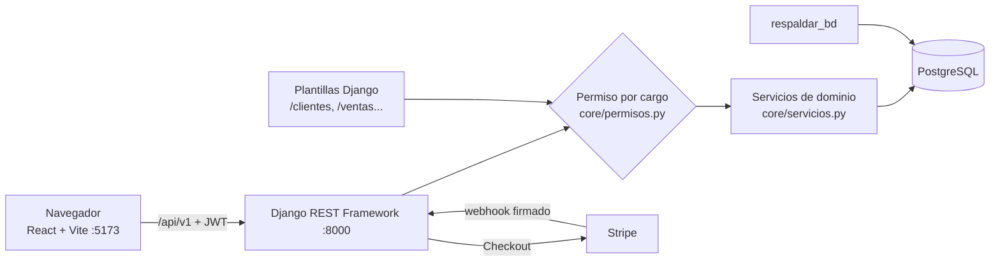

# Stack y arquitectura

## Stack del proyecto

| Capa | Tecnología | Versión | Para qué se usa |
|---|---|---|---|
| Lenguaje backend | Python | 3.12+ | Lógica de negocio y API |
| Framework web | Django | 6.0.7 | Modelos, ORM, administrador, vistas web con plantillas |
| API REST | Django REST Framework | 3.18.1 | Servicios JSON consumidos por React (y a futuro por la app móvil) |
| Autenticación | djangorestframework-simplejwt | 5.5.1 | Token JWT por ingreso, rotación y lista negra |
| Filtros | django-filter | 26.1 | `?estado=`, `?categoria=`… en los listados |
| Documentación de la API | drf-spectacular | 0.30.0 | OpenAPI 3: Swagger en `/api/docs/` y ReDoc en `/api/redoc/` |
| Pagos | stripe (SDK oficial) | 16.0.0 | Stripe Checkout y verificación de webhooks |
| Reportes | openpyxl / reportlab | 3.1.5 / 4.2.5 | Exportación a Excel y PDF |
| Configuración | python-dotenv | 1.0.1 | Secretos en `.env`, fuera de Git |
| Base de datos | PostgreSQL | 16 | Desarrollo, pruebas y producción (Railway) |
| Frontend | React | 19 | Interfaz de una sola página (SPA) |
| Enrutador | React Router | 7 | Navegación y rutas protegidas |
| Gráficas | Recharts | 3 | Dashboard |
| Empaquetador | Vite | 8 | Servidor de desarrollo con proxy `/api` → Django |
| Pruebas | unittest de Django, Vitest + Testing Library | — | 112 pruebas backend, 16 frontend |
| Calidad | Ruff (Python), Oxlint (JS) | 0.16.8 / 1.x | Estilo y errores comunes |
| Versionamiento | Git + GitHub | — | Ramas `feature/*` y pull requests |
| Editor | Visual Studio Code | — | Extensiones recomendadas en `.vscode/extensions.json` |

## Arquitectura



- **Cliente-servidor desacoplado**: React solo habla con la API. Django también conserva su interfaz con plantillas (la primera versión del proyecto), protegida con la misma matriz de permisos.
- **Sincronización frontend ↔ backend**: en desarrollo Vite reenvía `/api` a Django (`vite.config.js`), así el navegador ve un solo origen y no hace falta CORS. Toda escritura pasa por la API y queda en la base de datos; el inventario del dashboard se actualiza al recargar y la pantalla de inventario se refresca sola cada 30 s.
- **Servicios de dominio**: las operaciones que tocan varias tablas (registrar venta, confirmar pago) viven en `core/servicios.py` dentro de transacciones atómicas, para que la web y la API se comporten igual.

## Estructura de carpetas

```
Mining Star/
├── config/            settings.py (lee .env), urls.py
├── core/
│   ├── models.py      13 modelos
│   ├── permisos.py    matriz de acceso cargo × módulo
│   ├── servicios.py   ventas, pedidos y pagos (transacciones)
│   ├── pagos.py       integración con Stripe
│   ├── tablero.py     series del dashboard
│   ├── respaldos.py   copias de seguridad
│   ├── api/           serializadores, vistas y rutas REST
│   ├── views/         vistas web con plantillas
│   ├── management/commands/  respaldar_bd, restaurar_bd, cargar_demo
│   └── tests*.py      pruebas automatizadas
├── frontend/src/      React: pages/, components/, context/, api/
├── templates/ static/ interfaz web clásica
├── scripts/           .bat para Windows
└── docs/              esta documentación
```
