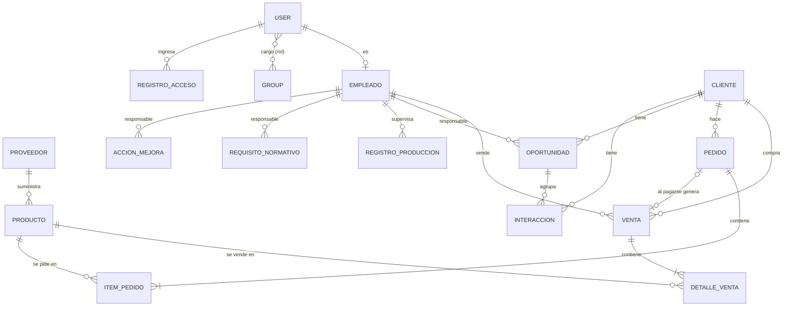

# Base de datos

Motor: SQLite en desarrollo (`db.sqlite3`). El código no usa nada específico de SQLite salvo el respaldo binario, así que migrar a PostgreSQL es cambiar `DATABASES` en `settings.py`.

## Modelo entidad-relación



## Tablas

| Tabla | Módulo | Novedad en esta versión |
|---|---|---|
| Cliente, Proveedor, Producto, Empleado, Venta, DetalleVenta | Núcleo | Empleado se vincula a su usuario; índice compuesto en Venta |
| RegistroProduccion | Producción (HU-001) | — |
| **RegistroAcceso** | Seguridad | Bitácora de ingresos con el identificador del token |
| **Oportunidad, Interaccion** | CRM | Embudo comercial e historial de contactos |
| **Pedido, ItemPedido** | Tienda | Carrito confirmado y su pago |
| **RequisitoNormativo** | Normativa | Obligaciones ante ANM, CORTOLIMA y otras entidades |
| **AccionMejora** | Mejora continua | Ciclo PHVA |
| auth_group | Seguridad | Un grupo por cargo (migración de datos 0010) |
| token_blacklist_* | Seguridad | Tokens de refresco invalidados |

## Mejoras aplicadas

1. **Integridad referencial con `PROTECT`**: no se puede borrar un cliente con ventas ni un producto ya vendido; la API responde 409 en vez de 500.
2. **Restricciones en la base, no solo en el formulario**: `stock` positivo, producción única por fecha-turno-material, un producto por pedido (`producto_unico_por_pedido`).
3. **Índices** donde el dashboard filtra y agrupa: `Venta(estado, fecha)`, `RegistroAcceso(nombre_usuario, evento, fecha)`, estados de pedido, normativa y PHVA.
4. **Precios congelados**: `ItemPedido.precio_unitario` y `DetalleVenta.precio_unitario` guardan el precio del momento de la compra.
5. **Transacciones atómicas** en ventas y pagos, con descuento condicional de stock (`UPDATE … WHERE stock >= n`) que evita vender dos veces la misma unidad.
6. **Idempotencia del pago**: confirmar dos veces el mismo pedido no duplica la venta ni descuenta dos veces (bloqueo `select_for_update`).
7. **Respaldo** consistente con la API de backup de SQLite + exportación JSON (ver documento 10).

## Comandos

```bash
python manage.py makemigrations   # tras cambiar un modelo
python manage.py migrate          # aplicar migraciones
python manage.py cargar_demo --clave "Demo*Mina2026"   # datos de demostración
```
