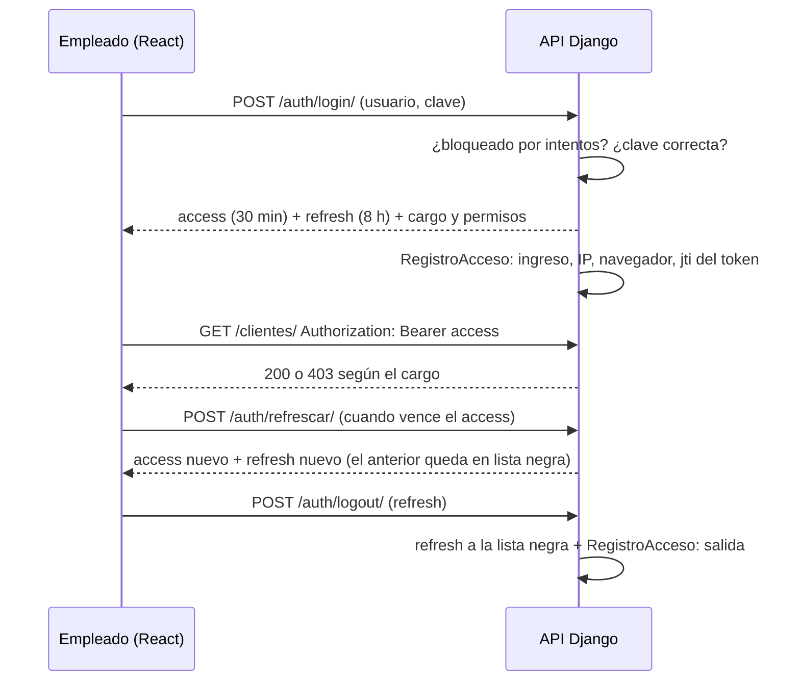

# Seguridad

## 1. Acceso por cargo (accesibilidad de cada empleado)

Cada usuario pertenece a un grupo con el nombre de su cargo. Lo que cada cargo puede hacer está en **una sola matriz**, `core/permisos.py`, que aplican la API, las vistas web y el menú de React.

| Módulo | Administrador | Gerente | Supervisor | Comercial | Contador | Operario | Auxiliar |
|---|---|---|---|---|---|---|---|
| Panel | VCEX | V | V | V | V | V | V |
| Clientes | VCEX | V | — | VCE | V | — | V |
| CRM | VCEX | VCEX | — | VCEX | — | — | — |
| Proveedores | VCEX | V | — | — | VCE | — | V |
| Productos e inventario | VCEX | V | V | V | V | — | VCE |
| Empleados | VCEX | V | V | — | — | — | — |
| Ventas | VCEX | V | — | VC | VE | — | — |
| Tienda y pagos | VCEX | V | — | VC | V | — | V |
| Producción | VCEX | V | VCE | — | — | VC | — |
| Normativa | VCEX | VCE | VCE | — | V | — | — |
| Mejora continua | VCEX | VCE | VCE | VC | VC | VC | VC |
| Seguridad | VCEX | V | — | — | — | — | — |

V = ver, C = crear, E = editar, X = eliminar. Se consulta también en el aplicativo: *Seguridad → Accesibilidad por cargo*.

- Un usuario **sin cargo** no puede usar ningún módulo.
- El **registro de usuarios ya no es público**: antes cualquiera podía crearse una cuenta y leer datos personales. Ahora solo el Administrador crea usuarios y les asigna cargo.
- Nadie puede cambiar su propio cargo ni desactivar su propia cuenta.
- El menú oculta lo que el cargo no puede usar, pero **la protección real está en el servidor**: aunque alguien escriba la URL o llame a la API, recibe 403.

## 2. Token de acceso por ingreso

- Cada ingreso emite un **JWT nuevo**; su identificador `jti` queda en la bitácora (*Seguridad → Bitácora de accesos*). Nunca se guarda el token completo.
- **Rotación**: cada renovación entrega un refresh nuevo y bloquea el anterior. Un token robado deja de servir.
- **Cierre de sesión real**: el refresh pasa a la lista negra del servidor.
- El token se guarda en `sessionStorage`, que se borra al cerrar la pestaña.
- La barra superior muestra hasta qué hora es válido el token actual.

## 3. Bloqueo por fuerza bruta

Tras **5 intentos fallidos** para un usuario (o 20 desde una IP) en 15 minutos, el login responde **429** aunque la clave sea correcta. Configurable en `.env` (`LOGIN_INTENTOS_MAXIMOS`). El mensaje de error es igual si el usuario no existe o si la clave está mal, para no revelar qué usuarios existen.

## 4. Otras medidas

| Medida | Dónde |
|---|---|
| Secretos fuera del código (`.env`, excluido de Git) | `config/settings.py` |
| Validación de contraseñas de Django (longitud, comunes, numéricas) | Registro y `cargar_demo` |
| HTTPS, HSTS, cookies seguras cuando `DEBUG=False` | `settings.py` |
| `X-Frame-Options: DENY`, `nosniff`, `Referrer-Policy` | `settings.py` |
| Bitácora de accesos de solo lectura en el admin | `core/admin.py` |
| Webhook de Stripe con verificación de firma | `core/pagos.py` |
| Los datos de tarjeta nunca pasan por el servidor (Stripe Checkout) | `core/pagos.py` |
| Ley 1581 de 2012: datos personales solo para cargos autorizados | Matriz de acceso |
| Respaldos excluidos de Git (contienen datos personales) | `.gitignore` |

## 5. Pendientes antes de producción

- Pasar a PostgreSQL y servir por HTTPS (Gunicorn + Nginx o un PaaS).
- Doble factor de autenticación para Administrador y Gerente.
- Registro de auditoría de cambios en datos (quién editó qué), por ejemplo con `django-simple-history`.
- Política de tratamiento de datos publicada y firmada por los titulares.
