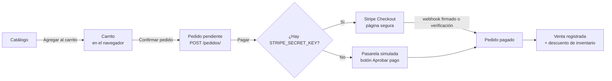

# Carrito de compras y pasarela de pagos Stripe

## Flujo



- Crear el pedido **no** descuenta inventario (un carrito abandonado no bloquea existencias). El descuento ocurre al confirmarse el pago, dentro de una transacción.
- El servidor recalcula precios y existencias: nunca confía en el total que envía el navegador.
- Confirmar el pago es **idempotente**: si Stripe avisa dos veces, la venta se crea una sola vez.

## Modo simulado (por defecto)

Si `STRIPE_SECRET_KEY` está vacío en `.env`, el carrito muestra "Pasarela en modo simulado" y un botón **Aprobar pago**. Sirve para la presentación sin cuenta de Stripe. Con llaves configuradas, el pago simulado queda prohibido (403).

## Modo prueba de Stripe (opcional)

1. Crear una cuenta gratuita en <https://dashboard.stripe.com/register> y dejarla en **modo de prueba** (Test mode).
2. Copiar la llave secreta de prueba (`sk_test_…`) en *Developers → API keys*.
3. En `.env`:
   ```
   STRIPE_SECRET_KEY=sk_test_xxxxxxxxx
   STRIPE_MONEDA=cop
   FRONTEND_URL=http://localhost:5173
   ```
4. Reiniciar Django. En el carrito aparece "Stripe activo (modo prueba)".
5. Pagar con la tarjeta de prueba **4242 4242 4242 4242**, cualquier fecha futura y cualquier CVC.
6. Al volver, la pantalla de resultado consulta a Stripe (`GET /pedidos/{id}/verificar/`) y registra la venta.

Webhook (opcional, para confirmar aunque el cliente cierre la pestaña): instalar Stripe CLI y ejecutar
`stripe listen --forward-to localhost:8000/api/v1/pagos/webhook/`; copiar el `whsec_…` que imprime en `STRIPE_WEBHOOK_SECRET`.

> **Nunca** se suben llaves a GitHub ni se usan llaves `sk_live_` en desarrollo.

## Endpoints

| Método | Ruta | Permiso |
|---|---|---|
| GET | `/api/v1/pagos/config/` | autenticado |
| GET/POST | `/api/v1/pedidos/` | pedidos: ver / crear |
| POST | `/api/v1/pedidos/{id}/pagar/` | pedidos: crear |
| GET | `/api/v1/pedidos/{id}/verificar/` | pedidos: ver |
| POST | `/api/v1/pedidos/{id}/confirmar-simulado/` | pedidos: crear (solo modo simulado) |
| POST | `/api/v1/pedidos/{id}/cancelar/` | pedidos: editar |
| POST | `/api/v1/pagos/webhook/` | público, con firma de Stripe |

## Limitación conocida

Si un producto se agota entre el pago y la confirmación, el pedido queda en estado **Fallido** y el reembolso se hace manualmente desde el panel de Stripe. En producción habría que reservar stock al iniciar el pago o automatizar el reembolso.
