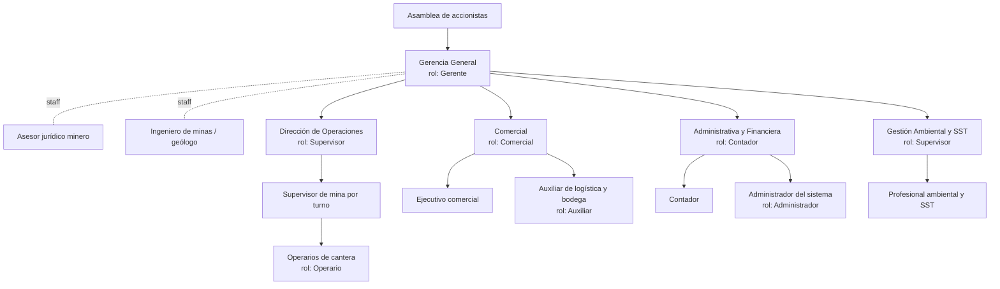

# Empresa y estrategia

> Fuente: documentos del proyecto minero del Título 15834 (análisis de mercado, fuerzas de Porter, lienzo Canvas y EDT). Aquí se usa **solo información general**: se excluyeron cifras financieras, datos personales de los titulares y el contenido marcado como confidencial. El mismo contenido se ve en el aplicativo, en **La empresa** (`frontend/src/datos/empresa.js`).

**Marca:** Mining Star Services and Products · **Razón social:** Ortega Espinosa y Compañía S.A.S.
**Operación:** cantera de mármol, travertino y caliza en Payandé, San Luis (Tolima).

## Misión
Extraer, transformar y comercializar mármol, caliza, recebo y sus derivados de forma legal, segura y trazable, para abastecer a la obra civil, la industria del cemento y el agro del centro del país, apoyados en un sistema de gestión digital que asegura el cumplimiento minero y ambiental.

## Visión 2030
En 2030 ser el proveedor formal de referencia de caliza y derivados en el corredor Payandé – Espinal – Ibagué, reconocido por su trazabilidad, su cumplimiento normativo y su gestión digital, y haber pasado de vender material de cantera a ofrecer productos con valor agregado como la cal agrícola y la marmolina.

## Valores
| Valor | Cómo se vive |
|---|---|
| Legalidad | Título, licencia y permisos al día. Nada se vende sin origen demostrable. |
| Seguridad primero | Ninguna meta de producción justifica un riesgo para las personas. |
| Respeto por el territorio | Cuidado del agua, el aire y la relación con la comunidad de Payandé. |
| Transparencia | Cada despacho, venta y pago queda registrado y es trazable. |
| Trabajo en equipo | Mina, ventas y administración comparten la misma información. |
| Mejora continua | Todo problema es una oportunidad de aprender (ciclo PHVA). |

## Cultura organizacional
**Principios:** nada se despacha sin registro en el sistema · la seguridad no se negocia (cualquiera puede detener una labor insegura) · decidimos con datos (el dashboard es la fuente única) · toda idea cuenta (cualquier empleado propone mejoras desde el aplicativo).

**Rituales:** charla de 5 minutos de seguridad al inicio del turno · revisión semanal de indicadores en el dashboard · reconocimiento mensual a la mejor mejora implementada · socialización trimestral con la comunidad.

## Estructura jerárquica

Cada cargo tiene un rol en el sistema que define su acceso (ver [Seguridad](03-seguridad.md)).

## Las cinco fuerzas de Porter
Escala 1 a 5 (5 = mayor presión sobre la rentabilidad).

| Fuerza | Nivel | Análisis | Respuesta |
|---|---|---|---|
| Nuevos entrantes | Baja (2) | Una concesión nueva ante la ANM toma años, la licencia ambiental suma más tiempo y se requiere capital alto. | El título vigente cerca del consumo es un activo escaso. |
| Poder de proveedores | Media-alta (4) | Explosivos con proveedor único autorizado; energía con distribuidor regional único. | Arrendar maquinaria al inicio y contratos anuales. |
| Rivalidad | Media-alta (4) | Grandes operadores integrados, pequeños productores y minería informal. | Diferenciarse por formalidad, trazabilidad y flete. |
| Sustitutos | Baja-media (2) | Sin sustituto económico para el cemento; en agregados compiten material de río y reciclados. | Ampliar hacia cal agrícola y marmolina. |
| Poder de compradores | Alta (5) | Mercado cementero concentrado; el material sin transformar se compra por precio y cercanía. | Ningún cliente por encima del 40 % de los ingresos; avanzar hacia productos transformados. |

## Agregación de valor
1. **Extracción legal** registrada por turno en el sistema (HU-001).
2. **Clasificación y trituración**: rajón, recebo y agregado con granulometría por uso.
3. **Molienda y empaque**: cal agrícola y marmolina, el mayor margen por tonelada.
4. **Venta digital**: catálogo, carrito, pago en línea y CRM.
5. **Entrega trazable**: factura electrónica y certificado de origen.
6. **Cumplimiento visible**: repositorio normativo con alertas.

## Factor diferencial
- **Fuente legal y trazable**: elimina el riesgo de comprar a la minería informal.
- **Cercanía al consumo**: en materiales de bajo valor por tonelada, el flete decide.
- **Calidad**: caliza calcítica de bajo magnesio, favorable para cemento y cal (por confirmar con muestreo representativo).
- **Gestión digital**: Mining Star ERP integra inventario, ventas, pagos, CRM y cumplimiento.

## Stakeholders (partes interesadas)

| Interesado | Tipo | Poder | Interés | Estrategia |
|---|---|---|---|---|
| Socios y titulares | Interno | Alto | Alto | Gestionar de cerca |
| Empleados | Interno | Bajo | Alto | Mantener informados |
| Clientes (obra civil, cementeras, agro, marmolerías) | Externo | Alto | Alto | Gestionar de cerca (CRM) |
| ANM | Regulador | Alto | Medio | Mantener satisfecho |
| CORTOLIMA | Regulador | Alto | Medio | Mantener satisfecho |
| Comunidad de Payandé | Externo | Medio | Alto | Mantener informada (PGS) |
| Proveedores | Externo | Medio | Medio | Monitorear |
| Inversionista u operador | Externo | Alto | Alto | Gestionar de cerca |
| DIAN, MinTrabajo, Alcaldía | Regulador | Medio | Bajo | Monitorear |
| SENA | Académico | Bajo | Medio | Mantener informado |

## Modelo de negocio (Canvas)

| Bloque | Contenido |
|---|---|
| Segmentos de clientes | Obra civil y vías del Tolima · cementeras y concreteras del corredor · distribuidores agrícolas · marmolerías y prefabricados |
| Propuesta de valor | Caliza y derivados con origen legal y trazable · menor flete · suministro sostenido bajo contrato · compra y pago en línea |
| Canales | Venta en boca de mina · tienda en línea · contratos industriales · distribuidores agrícolas · licitaciones |
| Relación con clientes | Contratos anuales · seguimiento con CRM · certificado de origen · atención técnica directa |
| Fuentes de ingreso | Rajón y agregados por tonelada · caliza para cemento · cal agrícola y marmolina · alternativa: regalía por contrato de operación |
| Recursos clave | Título vigente · licencia ambiental · yacimiento cercano al consumo · equipo técnico · Mining Star ERP |
| Actividades clave | Cumplimiento ante ANM y CORTOLIMA · perforación, voladura, cargue y transporte · trituración y molienda · comercialización · gestión digital |
| Socios clave | Inversionista u operador · proveedor autorizado de explosivos · alquiler de maquinaria · laboratorio y geólogo · transportadores · comunidad |
| Estructura de costos | Fijos: nómina, pólizas, impuestos · variables: explosivos, combustible, maquinaria, regalías · de entrada: saneamiento, estudios, vías |

## EDT

### EDT del proyecto de software (MVP)
| Código | Paquete | Entregables |
|---|---|---|
| 1 | Gestión del proyecto | Plan de trabajo · control de versiones (Git, ramas, PR) · seguimiento con el instructor |
| 2 | Análisis | Requisitos · historias de usuario (HU-001, HU-003) · casos de uso |
| 3 | Diseño | Modelo E-R · prototipo · arquitectura y API REST |
| 4 | Construcción | Backend · frontend · seguridad y tokens · CRM y tienda · normativa y mejora · dashboard |
| 5 | Pruebas | Plan · casos · pruebas automatizadas · pruebas funcionales |
| 6 | Entrega | Documentación · respaldo · presentación del MVP |

### EDT de la empresa (reactivación del título)
| Código | Paquete | Subpaquetes |
|---|---|---|
| 1 | Gestión del proyecto | Dirección · seguimiento jurídico · relación con el inversionista · control documental |
| 2 | Saneamiento minero (ANM) | Póliza · FBM · regalías · PTO · RUCOM |
| 3 | Saneamiento ambiental (CORTOLIMA) | Estado de la licencia · emisiones · modificación de la licencia |
| 4 | Estudios técnicos | Campo · geofísica · laboratorio · recursos y reservas |
| 5 | Gestión social | Plan de Gestión Social · relacionamiento |
| 6 | Estructuración de la inversión | Data room · debida diligencia · contrato de entrada |
| 7 | Puesta en operación | Vías · infraestructura · maquinaria · comercialización · arranque |
