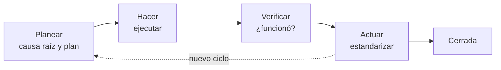

# Sistema de mejora continua (PHVA)

Módulo **Mejora continua** (`/mejora`, API `/api/v1/mejora/`).

| Elemento | Detalle |
|---|---|
| ¿Quién propone? | Cualquier empleado, incluido el operario (cultura "toda idea cuenta") |
| Orígenes | Sugerencia de empleado, auditoría, queja de cliente, incidente SST, hallazgo ambiental, indicador fuera de meta |
| Tipos | Correctiva (ya pasó), preventiva (puede pasar), oportunidad de mejora |
| ¿Quién la mueve? | Supervisor, Gerente y Administrador |
| Regla de cierre | **No se cierra sin registrar la verificación de eficacia** (validación en el servidor) |
| Seguimiento | Gráfica "Mejora continua (PHVA)" en el dashboard |

Rituales asociados: revisión semanal de acciones abiertas y reconocimiento mensual a la mejor mejora implementada (ver [cultura](06-empresa-y-estrategia.md#cultura-organizacional)).
