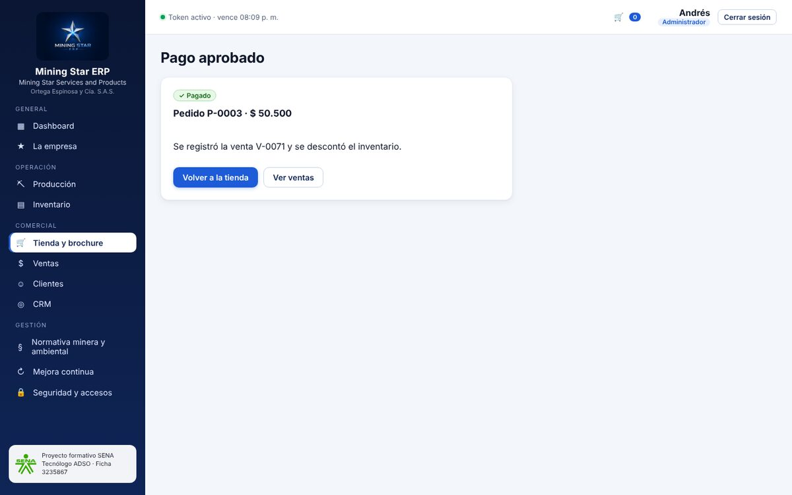
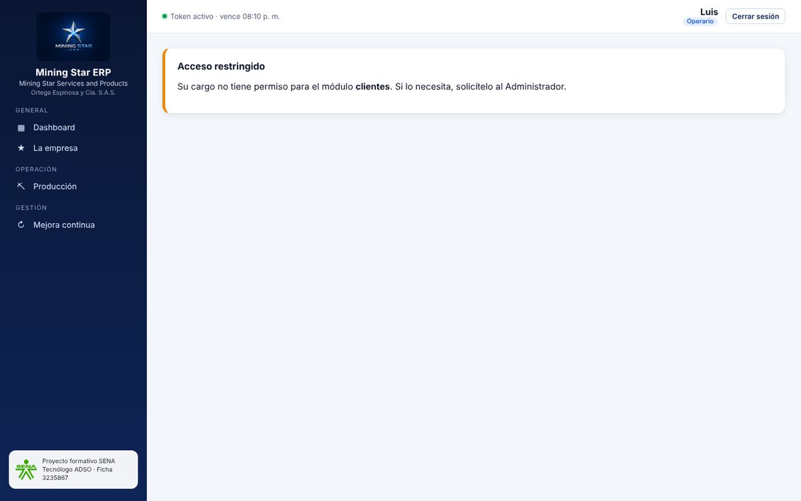

# Plan de pruebas de software

Apoya las evidencias de la Guía 9: **GA9-220501096-AA1-EV02** (plan de pruebas), **AA2-EV01** (casos y ambiente: `docs/pruebas/Casos_de_prueba_Mining_Star.xlsx`) y **AA3-EV01/EV02** (ejecución y reporte).

## 1. Objetivo
Verificar que Mining Star ERP cumple los requisitos funcionales del MVP y, sobre todo, que **rechaza lo que debe rechazar**: accesos sin permiso, tokens reutilizados, pagos falsos, ventas sin stock y cierres de acciones sin verificar.

## 2. Alcance
| Funcionalidades existentes (regresión) | Funcionalidades nuevas |
|---|---|
| Clientes, proveedores, productos, empleados, ventas (HU-003), producción (HU-001), reportes Excel/PDF, API REST | Permisos por cargo, token por ingreso y bitácora, bloqueo por intentos, CRM, carrito y pagos Stripe, normativa, mejora continua, dashboard, respaldos |

## 3. Estrategia y tipos de prueba
| Tipo | Qué se prueba | Herramienta |
|---|---|---|
| Unitarias | Reglas de modelos (alertas de vencimiento, matriz de permisos) | Django `TestCase` |
| Integración / API | Endpoints con base de datos real temporal: estados HTTP, validaciones, transacciones | DRF `APITestCase` |
| Seguridad | 401/403/429, lista negra de tokens, firma de webhook, registro restringido | DRF `APITestCase` |
| Interfaz (componentes) | Login, tabla, validaciones, menú por cargo | Vitest + Testing Library |
| Funcionales de extremo a extremo | Flujo de compra y acceso restringido en el navegador | Playwright |
| Calidad estática | Estilo y errores comunes | Ruff, Oxlint |

**Criterio de aceptación:** 100 % de pruebas automatizadas en verde, cero errores de Ruff y Oxlint, y flujo de compra completo sin errores en la consola del navegador.

## 4. Ambiente
| Elemento | Detalle |
|---|---|
| Hardware | Portátil del aprendiz, 8 GB RAM o más |
| Sistema operativo | Windows 11 (desarrollo); Linux (ejecución automatizada) |
| Software | Python 3.12+, Node.js 20+, Django 6.0.7, React 19, Chrome |
| Datos | Base temporal creada por cada prueba; para pruebas manuales, `cargar_demo` |

## 5. Cómo ejecutar
```bash
python manage.py test core          # 112 pruebas backend
cd frontend && npm test             # 16 pruebas frontend
ruff check .                        # calidad Python
cd frontend && npm run lint         # calidad JavaScript
```

## 6. Resultados (6 de octubre de 2026)
| Conjunto | Pruebas | Aprobadas | Fallidas |
|---|---|---|---|
| Backend (`core.tests`, `core.tests_api`, `core.tests_mvp`) | 112 | 112 | 0 |
| Frontend (Vitest) | 16 | 16 | 0 |
| Funcionales en navegador (Playwright) | 2 | 2 | 0 |

Hallazgos corregidos durante la ejecución: la pantalla de Producción pedía la lista de empleados también al Operario, que no tiene ese permiso (403 en consola); ahora solo se pide si el cargo puede verla.

## 7. Riesgos y contingencias
| Riesgo | Contingencia |
|---|---|
| Stripe no disponible o sin llaves en la presentación | Modo simulado automático |
| Base de datos dañada durante la demostración | `restaurar_bd` desde el respaldo creado por `preparar_demo.bat` |
| Fallas de red | Todo corre en local (127.0.0.1) |
| Cambios que rompen funciones existentes | Las 112 pruebas se ejecutan antes de cada pull request |

## 8. Cronograma
| Fecha | Actividad |
|---|---|
| 6 oct | Diseño de casos y ejecución automatizada |
| 7–8 oct | Pruebas funcionales en el equipo del aprendiz con los 7 cargos |
| 9 oct | Ajustes y reporte |
| 12 oct | Entrega GA9-AA3-EV01 y EV02 |

## Evidencias
| Pago aprobado | Acceso restringido (Operario) |
|---|---|
|  |  |
