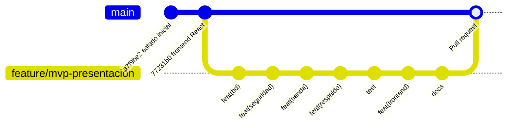

# Flujo Git e integración de versiones (pull request)

## Estrategia de ramas



- `main` siempre debe funcionar: no se trabaja directamente sobre ella.
- Cada mejora va en una rama `feature/…` y entra a `main` por **pull request**, después de pasar las pruebas.
- Mensajes de commit con *Conventional Commits*: `feat:`, `fix:`, `test:`, `docs:`, `refactor:`, `chore:`.

## Pasos para subir esta versión y abrir el pull request

Desde la terminal de VS Code, en la carpeta del proyecto:

```bash
git status                                   # debe decir: On branch feature/mvp-presentacion
git log --oneline -8                         # revisar los commits
git push -u origin feature/mvp-presentacion  # sube la rama a GitHub
```

Luego en GitHub: **Compare & pull request** → base `main` ← compare `feature/mvp-presentacion` → pegar la descripción de `docs/PULL_REQUEST.md` → **Create pull request** → revisar la pestaña *Files changed* → **Merge pull request**.

Con GitHub CLI (opcional):

```bash
gh pr create --base main --head feature/mvp-presentacion --title "MVP: seguridad por cargo, dashboard, CRM, tienda con Stripe y gestión" --body-file docs/PULL_REQUEST.md
```

Después de fusionar:

```bash
git checkout main
git pull
```
